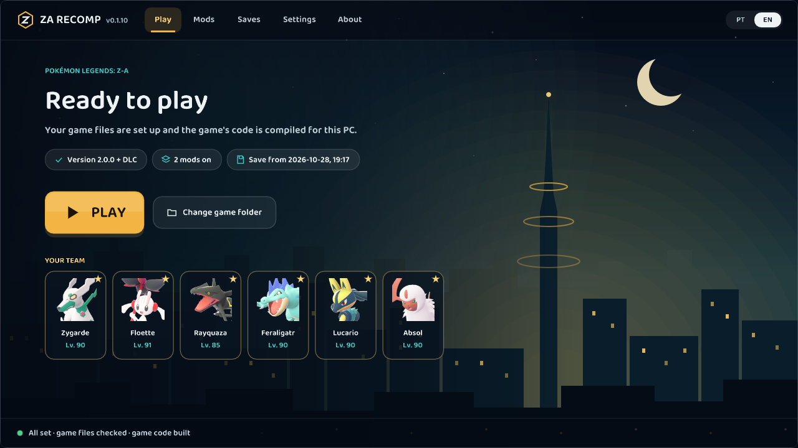

<div align="center">


# ZA Recomp

**A native PC port of *Pokémon Legends: Z-A*, built by static recompilation.**

**English** · [Português (Brasil)](README.pt-BR.md)

[Download](https://github.com/Hexveil404/PokeZ-ARecomp/releases/latest) ·
[Report a bug](https://github.com/Hexveil404/PokeZ-ARecomp/issues) ·
[macOS port (MonZaMac)](https://github.com/lucabravi/MonZaMac)

</div>

---

ZA Recomp turns the game's Nintendo Switch code into a native Windows program. The ARM64 code is translated ahead of
time into C and compiled for x86-64 on your PC, and the Switch's operating system and GPU (NVN) are reimplemented on
top of Vulkan. No emulator runs while you play.

It is built on **[LAS Recomp](https://github.com/peiikai/LASRecomp)** by Peiikai, the static recompiler made for
*The Legend of Zelda: Link's Awakening*.

> [!IMPORTANT]
> **You need your own copy of the game.** ZA Recomp does not include any game files, code, assets or fonts.

## Contents

- [Screenshots](#screenshots)
- [Features](#features)
- [Requirements](#requirements)
- [Installation](#installation) ([Mega Dimension DLC](#mega-dimension-dlc), [Linux (experimental)](#linux-experimental))
- [Controls](#controls)
- [Saves](#saves)
- [Mods](#mods)
- [Multiplayer (test)](#multiplayer-test)
- [Troubleshooting](#troubleshooting)
- [Building from source](#building-from-source)
- [Developer tools](#developer-tools)
- [Credits](#credits)
- [Legal](#legal)

## Screenshots

| | |
|---|---|
|  |  |
| Lumiose City at 60 fps | The start screen, with your team |
|  |  |
| The game's menu (with a translation mod) | The bag |

## Features

**Performance**
- 60 fps at the game's normal speed, or 30 fps as on the Switch
- Internal resolution from 25% up to 4x (1x = 1080p), plus Dynamic and Match display
- Frame pacing option (Smooth / Standard) for displays where the frame rate looks uneven

**Graphics** (all optional, off by default)
- Upscaling with AMD FSR 1, anti-aliasing with SMAA or AMD FSR 2 (temporal), sharpening
- HDR output (HDR10 / scRGB)
- Ambient occlusion (GTAO), indirect light (screen-space GI) and water reflections
- Sharper shadows (higher shadow map resolution) and high-quality texture filtering
- HD texture packs (`textures/hd/`)
- Graphics API (Windows): Vulkan, or DirectX 12 for cards whose Vulkan driver crashes the game (see
  [DirectX 12](#directx-12))

**Controls**
- Any SDL3 controller: Xbox, PlayStation (DualShock 4 / DualSense), Switch Pro, Steam Deck and more
- Keyboard and mouse, with a mouse-driven camera
- Every button and key can be rebound; button icons match your controller (Xbox, PlayStation, Nintendo, Steam Deck,
  keyboard). Xbox / PlayStation / Steam pads use their own A/B/X/Y labels; Nintendo pads keep the Switch positions
- Battle moves by position, right stick snap to axis

**Start screen**
- Sets the game up from your own files and compiles it once on your PC
- Mods manager (romfs mods), save import / export and backups
- English and Portuguese (Brazil)

## Requirements

| | |
|---|---|
| **OS** | Windows 10 (1903 or newer) or Windows 11, 64-bit. Linux x86-64: experimental, see [Linux](#linux-experimental) |
| **CPU** | x86-64 with AVX2 (2013 or newer). Older CPUs with SSE4.2 also work, but compile and run slower |
| **GPU** | Vulkan 1.2 or newer (1.3 recommended) with an up-to-date driver. With the DirectX 12 option: a DirectX 12 card (feature level 11_0, shader model 6.0) |
| **RAM** | 8 GB (16 GB recommended) |
| **Disk** | About 12 GB free |
| **Game** | Pokémon Legends: Z-A **1.0.0, 2.0.0 or 2.0.2**, optionally with the *Mega Dimension* DLC |

Linux runs natively (x86-64, no Wine or Proton) as an **experimental** build: see [Linux (experimental)](#linux-experimental).
On a Mac, use [MonZaMac](https://github.com/lucabravi/MonZaMac) by
[@lucabravi](https://github.com/lucabravi), a native macOS port based on this project.

## Installation

1. Download the latest `ZA-Recomp-windows.zip` from [Releases](https://github.com/Hexveil404/PokeZ-ARecomp/releases/latest)
   and extract it to a folder of your choice (for example `C:\Games\ZA Recomp`).
2. Prepare your own copy of the game in a folder, in one of two ways:
   - **Extracted game**: the `exefs` and `romfs` folders, as an emulator or your Switch extracts them. No keys needed.
   - **Dump**: the base game (`.xci` or `.nsp`), optionally the update and the *Mega Dimension* DLC (`.nsp`), together with the
     `prod.keys` from your own Switch.
3. Run `lasrecomp.exe`. On the start screen, choose that folder (or drag it onto the window) and click
   **Set up the game**.
4. The game's files are read and its code is compiled for your PC. This takes 10 to 30 minutes depending on your CPU
   and happens **only once**. After an update of ZA Recomp, only what changed is compiled again.
5. Click **Play**.

Your own files are never changed. Optionally, import your console's fonts on the start screen (**Settings > Files**)
for the original text and button icons; without them a substitute font is used.

### Mega Dimension DLC

The DLC is supported through the **dump** route (the extracted `exefs` / `romfs` folders don't include it):

1. Put these files together in one folder: the base game (`.xci` or `.nsp`), the **update** (`.nsp`, version 2.0.0 or
   newer - the DLC's content comes with it), the **DLC** (`.nsp`) and the `prod.keys` from your Switch (plus
   `title.keys` if the start screen asks for it).
2. Choose that folder on the start screen and click **Set up the game**.
3. The start screen shows **+ DLC** next to the game version when it was found.

Already set up without the DLC? Click **Change game folder**, choose the folder again with the DLC added and set it up
again. Your saves and settings are kept.

### Linux (experimental)

ZA Recomp runs natively on Linux x86-64, without Wine or Proton. When a release has Linux files, pick one:
`zarecomp_<version>_amd64.deb` (Ubuntu / Linux Mint / Debian: `sudo apt install ./zarecomp_<version>_amd64.deb`, then
**ZA Recomp** in the menu or `zarecomp` in a terminal), the `.AppImage` (`chmod +x` it and start it), or the `.zip`
(unpack it anywhere and start `./zarecomp`), then set up your game as in step 3 below. Otherwise you build it once on your
machine (the scripts do everything).

**Tested so far:** Linux Mint 22.3 with an Intel UHD integrated GPU and 8 GB of RAM, Pokémon Legends: Z-A 2.0.2. Cutscenes,
audio and walking around work; on that integrated GPU 3D scenes run at about 15-26 fps (menus at 60). Controllers,
saves, mods, other GPUs and long sessions have not been tested yet - reports are welcome.

**Needs:** a 64-bit distribution with glibc 2.35 or newer (Ubuntu 22.04+, Linux Mint 21+, Debian 12, Fedora, Arch...),
a Vulkan 1.3 driver (Mesa or NVIDIA's), a CPU with AVX2, 8 GB of RAM and about 12 GB free. The commands below are for
Ubuntu / Linux Mint / Debian; other distributions have the same packages under their own names (on Debian,
`dotnet-sdk-8.0` comes from Microsoft's package repository).

1. Install the build tools and libraries (once):

   ```bash
   sudo apt install git clang lld cmake ninja-build nasm pkg-config python3-venv curl patchelf dotnet-sdk-8.0 \
       libx11-dev libxext-dev libxrandr-dev libxcursor-dev libxi-dev libxss-dev libxfixes-dev libxtst-dev \
       libxkbcommon-dev libwayland-dev wayland-protocols libdecor-0-dev libegl-dev libdrm-dev libgbm-dev \
       libpulse-dev libasound2-dev libpipewire-0.3-dev libdbus-1-dev libudev-dev libibus-1.0-dev libvulkan-dev
   ```

2. Get the source and build the AppImage (downloads and builds its libraries the first time, which takes a while):

   ```bash
   git clone https://github.com/Hexveil404/PokeZ-ARecomp.git
   cd PokeZ-ARecomp
   tools/za/dist-linux.sh
   ```

   The result is `build/dist/ZA Recomp-<version>-linux-x86_64.AppImage` (plus the same files as a `.zip` and a `.deb`).
   Copy it wherever you like.

3. Start it (`chmod +x` it first if needed). On the start screen, choose your game folder (extracted `exefs` + `romfs`,
   or your `.xci` / `.nsp` files with your `prod.keys`) and click **Set up the game**, then **Play**, as on Windows.
   Your settings, saves and game files are kept in `~/.local/share/zarecomp`.

If the setup from the start screen fails, there is a manual route, which is the one tested end to end so far.
Replace the paths with your own files:

```bash
tools/za/build-linux.sh                       # the app
build/linux/x86_64/zaimport/zaimport ~/path/to/prod.keys extracted ~/path/to/base.nsp ~/path/to/update.nsp
GAME=1 JOBS=3 tools/za/build-linux.sh         # compiles the game code: about 20 minutes, once
build/linux/x86_64/za/lasrecomp extracted --play
```

On an integrated GPU, lower **Resolution** in the F1 menu for a smoother frame rate. More details, other options and
known problems: [docs/linux.md](docs/linux.md#za-recomp-on-linux-native-x86-64).

## Controls

Press **F1** in game (or open **Settings** on the start screen) for the settings menu: frame rate, resolution,
graphics options, controls, button icons and more. Settings are saved immediately to `larecomp.ini`.

On its first start, ZA Recomp picks the resolution and frame rate for your PC (from your GPU, CPU and RAM); an
install from an earlier version is asked once on the start screen whether to use them. With 60 fps, **Drop to 30 fps
when needed** (off by default) goes back to 30 fps when your PC can't keep 60, instead of slow motion.

| Keyboard (default) | Switch |
|---|---|
| W A S D | Left stick |
| Arrow keys | D-pad |
| K / J / L / I | A / B / X / Y |
| Q / E | L / R |
| 1 / 3 | ZL / ZR |
| Enter / Backspace | + / − |
| F / Numpad 0 | Left / right stick click |
| Numpad 8 / 4 / 5 / 6 | Right stick |
| Mouse | Camera; left button ZR (throw), right button ZL (aim) |

| Key | Action |
|---|---|
| F1 / Esc | Settings menu |
| F11 / Alt+Enter | Fullscreen |
| F10 | Screenshot (`screenshots/`) |

All bindings can be changed in **Settings > Controls > Configure inputs**.

**Xbox attack layout** (off by default) places the four battle moves at their configured physical face buttons,
without changing controls. Setup prepares the private UI resource automatically from your own game files.
Leave **Battle moves by position** off, enable the Xbox option, then restart. See
[Xbox attack layout](docs/XBOX-ATTACK-LAYOUT.md) for compatibility and troubleshooting.

## Saves

Saves are the game's own files, kept in `save/save_0/` next to `lasrecomp.exe`. They are the same as on the Switch, so
they move between the two without conversion. The **Saves** page on the start screen imports, exports and restores
backups; every import keeps your previous save as a backup.

- **Switch → PC**: back up the save with **JKSV** on your Switch, copy the backup folder (it holds a file named `main`)
  to your PC and import it on the **Saves** page.
- **PC → Switch**: export the save, copy its files into a JKSV backup folder on the SD card and restore it with JKSV.
- **Game versions**: a 2.0.x save needs the game set up with the 2.0.x update. Version 2.0.0 converts a 1.0.0 save the
  first time it saves, and the converted save no longer loads on 1.0.0. Keep a backup.

## Mods

Mods that replace game files (a `romfs` folder): translations, textures, models. Install them from the **Mods** page
(or drop the mod onto the window); they are kept in `mods/`. When two mods replace the same file, the one higher in the
list wins.

Mods that change the game's code (`exefs`, IPS patches, cheat plugins) do not work with a recompiled game.

## Multiplayer (test)

> **This is a test feature.** It may not connect on every network, and it may change or be removed in a later
> version. Please report how it works for you.

Pokémon Legends Z-A's **Link Play** (link trades and private battles) works between two copies of ZA Recomp, with no
server and no account.

**Same network (home LAN, or a virtual LAN like Radmin VPN / ZeroTier / Hamachi):** nothing to set up. In the game,
**Link Play > Nearby Players** finds the other PC as it would find a nearby Switch. Then use the game's own link code
or room passcode, as on the console.

**Over the internet:**
1. Both players open **F1 > Online** in game and copy **Your code** (A / click copies it).
2. Send it to your friend (WhatsApp, Discord...) and paste theirs with **Paste friend's code** (it's read from the
   clipboard). Both of you have to paste the other's code.
3. Wait for **Status: Connected**, usually within a minute. Then use **Link Play > Nearby Players** in the game as
   above.

If it says **Didn't connect**, one of the two networks blocks direct connections (some mobile networks and
corporate routers). A virtual LAN (Radmin VPN, ZeroTier, Hamachi) works around that, and then no codes are needed.

### How it works

- **Local wireless, emulated:** the Switch's local wireless and the game's network sockets are re-created on top of
  normal UDP on your PC (ports 47810-47817 on a LAN). The game sends and receives the same data it would on a console.
- **Connection codes:** your code holds your public internet address and port, as seen from outside (learned from
  public STUN servers: Google, Cloudflare), plus a random **session token** made when the game starts.
- **No server in the middle:** after both codes are pasted, the two games send packets straight to each other until
  both routers let them through ("hole punching"). They try at fixed times of the clock, using the time from public
  NTP servers (Cloudflare, Google, pool.ntp.org), so the PCs' own clocks don't need to be right. No ports to forward
  and nothing changed on your router.
- **What is sent:** only what the game itself sends during Link Play (the trade or battle data, as on the console).
  Your save file, your game files and your keys never leave your PC.

### Security

- **Your code shows your IP address.** Share it only with the person you're playing with, as with any direct
  (peer-to-peer) game. Codes change every time the game starts, and nothing listens on the internet once the game is
  closed.
- **Friends only:** over the internet, the game only accepts players whose code you pasted. Every packet is signed
  (HMAC-SHA1) with a key made from both players' session tokens. Packets from anyone else, or that fail the check,
  are dropped before the game sees them, and so are floods (over 4000 packets a second).
- **Signed, not encrypted:** nobody else can inject or change what you send, but the trade data itself isn't hidden
  from someone who can watch your traffic (your network or internet provider). It is the game's own trade data, so
  nothing personal.
- **Same network:** local play isn't signed, just like a Switch's local wireless. Anyone on your LAN or virtual LAN can
  see your room, and the game's own link code or passcode decides who gets in.
- **Trust who you play with:** the other player's game sends data that your game processes, as on a console. Play
  with people you know.
- No accounts, no data sent to us: the project has no server at all. The only outside services used are the public
  STUN and NTP servers above, which see your address and nothing else.

### Why it works this way (and why there's no ranked mode)

- **Ranked battles, random matchmaking and "Faraway Players" trades need a server** that is always online: to find
  opponents you don't know, keep rankings and check results. In the original game those run on Nintendo's servers,
  which a PC port can't (and shouldn't) use.
- **ZA Recomp has no servers and doesn't ask for donations or any money.** Running a public server costs money every
  month and needs someone to keep it up and secure, so there is no ranked or matchmaking mode, and none is planned for
  now.
- **What you can do today:** link trades and private battles with friends, game to game, over the internet or on the
  same network, using the steps above. Nothing in between can go offline, and nobody but your friend is involved.

## DirectX 12

ZA Recomp normally runs on your graphics card's **Vulkan** driver. On Windows it can also run the same renderer on the
card's **DirectX 12** driver, which helps where the Vulkan driver crashes or misdraws the game (some AMD cards).

- **Turn it on**: **F1 > Display > Graphics API: DirectX 12** in game. It applies from the next start. If DirectX 12 fails to start, the next start uses Vulkan again by itself.
- **How it works**: it uses [Mesa](https://mesa3d.org)'s Dozen (a Vulkan implementation on top of Direct3D 12), built
  with this game's fixes and shipped in the `dx12` folder, plus the Direct3D 12 Agility SDK in the `D3D12` folder. Keep
  both folders next to `lasrecomp.exe`.
- **Status**: new and experimental. On an RTX 4060 Ti it draws the same picture as Vulkan at the same speed; it has
  not been tested on AMD or Intel cards yet - please report how it runs on yours.
- **First start**: the first start on DirectX 12 prepares the shaders you have already seen in the game once (it can take a few minutes); after that it takes under a second.
- **Logs**: `logs/play.log` has a `graphics API: DirectX 12 (Dozen, ...)` line when it is on.

## Troubleshooting

- **Logs**: each session writes `logs/play.log` next to the exe (the previous one is kept as `logs/play-anterior.log`).
  Please attach it to any bug report.
- **Graphics driver errors** ("Your graphics driver crashed", a GPU page fault): open
  **Settings > Video > Compatibility** and turn the options off one at a time. They apply from the next start.
- **The game crashes on Vulkan** (often on AMD cards): try **F1 > Display > Graphics API: DirectX 12**
  ([DirectX 12](#directx-12)).
- **Low frame rate**: lower the internal resolution or turn on Dynamic resolution, and turn off the optional graphics
  features.
- **Report a bug**: [open an issue](https://github.com/Hexveil404/PokeZ-ARecomp/issues) with your GPU, driver version,
  game version and `logs/play.log`.

## Building from source

ZA Recomp builds on Windows with MSYS2 (UCRT64: clang, SDL3, FFmpeg, shaderc, Vulkan headers) and Python 3. See
[docs/BUILD-windows.md](docs/BUILD-windows.md) for the setup. `bash tools/za/dist.sh` builds the release folder
(`build/dist-za/ZA Recomp/`; `ZIP=1` for the zip), which ships without any game code: the start screen compiles it on
the player's PC. It also builds the DirectX 12 files once (`tools/dx12/build_dozen.sh`: Mesa 26.2.5 with
`tools/dx12/dozen-za.patch`; needs meson, ninja, python-mako, python-yaml, bison, flex, git and 7-Zip).

Where things are: the recompiler is in `tools/`, the runtime in `runtime/` (HLE services, the NVN implementation in
`runtime/nvn/`, the Vulkan backend in `runtime/nvn/vulkan/` and the Maxwell shader translator in
`runtime/nvn/maxwell/`), and the Pokémon Z-A tools in `tools/za/`.

Contributions are welcome. Never commit or attach Nintendo files (game files, extracted data, generated code, fonts,
saves).

## Developer tools

For anyone working on the port itself. Players don't need these, and they stay off in a normal run.

- **ZA DevTools**: a separate program with the live log, performance graphs and a frame inspector. You can mark a bug
  while playing, then replay up to that moment.
- **Record and replay**: `tools/za/replay-record.sh` and `tools/za/replay-play.sh`.
- **Frame captures**: every pass and draw of a frame, with analysis scripts in `tools/devtools/analysis/`.

The [developer tools guide](docs/dev-tools.md) covers setup and how to use each one. To build ZA DevTools on Windows:
`bash tools/devtools/build.sh`.

## Credits

- **[Peiikai](https://github.com/peiikai)**: creator of [LAS Recomp](https://github.com/peiikai/LASRecomp), the static
  recompiler, runtime, renderers and shader translator this port is built on.
- **[Hexveil404](https://github.com/Hexveil404)**: the Pokémon Legends: Z-A port.
- **ZA Recomp contributors**: [@Primus92](https://github.com/Primus92), [@Atterax](https://github.com/Atterax),
  [@wimw85](https://github.com/wimw85), [@lucabravi](https://github.com/lucabravi),
  [@gabrielsem16-bot](https://github.com/gabrielsem16-bot), [@gdsistemas-web](https://github.com/gdsistemas-web) and
  everyone who reported issues and tested builds.
- **LAS Recomp contributors**: see [docs/LASRecomp-README.md](docs/LASRecomp-README.md#credits).
- **[Ryujinx](https://github.com/Ryujinx/Ryujinx)**, used as a behavioural reference (no code taken),
  **[envytools](https://github.com/envytools/envytools)** and **[Switchbrew](https://switchbrew.org)** for GPU and
  system documentation.
- **Libraries**: [SDL 3](https://libsdl.org), [FFmpeg](https://ffmpeg.org), [Dear ImGui](https://github.com/ocornut/imgui),
  [Vulkan Memory Allocator](https://github.com/GPUOpen-LibrariesAndSDKs/VulkanMemoryAllocator),
  [shaderc](https://github.com/google/shaderc), [SMAA](https://github.com/iryoku/smaa),
  [AMD FidelityFX FSR 1 and FSR 2](https://github.com/GPUOpen-Effects), [XeGTAO](https://github.com/GameTechDev/XeGTAO),
  [LibHac](https://github.com/Thealexbarney/LibHac), [Zig](https://ziglang.org) and the others listed in
  [docs/LASRecomp-README.md](docs/LASRecomp-README.md#license).

## Legal

ZA Recomp is a fan project. It is not affiliated with, endorsed or sponsored by Nintendo, Game Freak, Creatures or
The Pokémon Company. *Pokémon* and *Pokémon Legends: Z-A* are trademarks of their respective owners. No game files,
code, assets or fonts are included; you must provide your own legally obtained copy of the game.

The code is released under the [MIT License](LICENSE) (LAS Recomp © Peiikai). Third-party components keep their own
licenses; see [docs/LASRecomp-README.md](docs/LASRecomp-README.md#license). DirectX 12 (F1 > Display >
Graphics API) runs the same renderer through [Mesa](https://mesa3d.org)'s Dozen (Vulkan on Direct3D 12, MIT), built
by `tools/dx12/build_dozen.sh` with the fixes in `tools/dx12/dozen-za.patch`, with Microsoft's `dxil.dll` and the
Direct3D 12 Agility SDK's `D3D12Core.dll` (Microsoft's redistributable files, under their own licence, shipped in
`dx12/` and `D3D12/`). The NVIDIA DLAA integration
(`runtime/nvn/vulkan/dlaa.c`) follows [totk-pc-recomp](https://github.com/valentderah/totk-pc-recomp)'s
`runtime/vk_dlaa.c` (MIT). DLAA uses NVIDIA DLSS: `nvngx_dlss.dll` is NVIDIA's (NVIDIA RTX SDK license) and isn't
included; NVIDIA, DLSS and DLAA are trademarks of NVIDIA Corporation.
