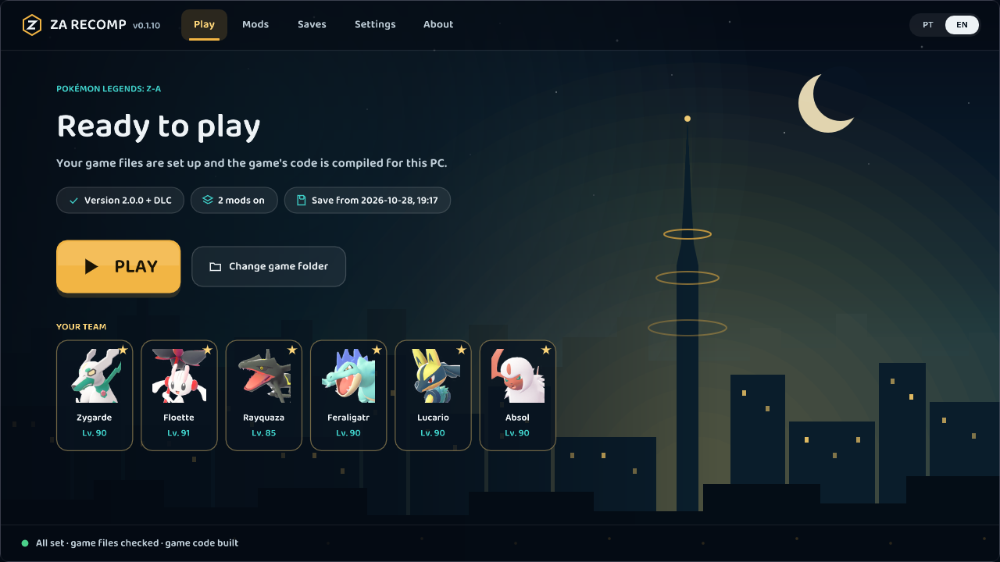

# ZA Recomp

**A native PC port of *Pokémon Legends: Z-A*, built by static recompilation.**

**English** · [Português (Brasil)](README.pt-BR.md)

[Download](https://github.com/Hexveil404/PokeZ-ARecomp/releases/latest) ·
[Report a bug](https://github.com/Hexveil404/PokeZ-ARecomp/issues) ·
[macOS port (MonZaMac)](https://github.com/lucabravi/MonZaMac)

---

ZA Recomp turns the game's Nintendo Switch code into a native Windows program. The ARM64 code is translated ahead of
time into C and compiled for x86-64 on your PC, and the Switch's operating system and GPU (NVN) are reimplemented on
top of Vulkan. No emulator runs while you play.

It is built on **[LAS Recomp](https://github.com/peiikai/LASRecomp)** by Peiikai, the static recompiler made for
*The Legend of Zelda: Link's Awakening*.

> [!IMPORTANT]
> **You need your own copy of the game.** ZA Recomp does not include any game files, code, assets or fonts.

## Contents

- [Screenshots](#screenshots)
- [Features](#features)
- [Requirements](#requirements)
- [Installation](#installation) ([Mega Dimension DLC](#mega-dimension-dlc))
- [Controls](#controls)
- [Saves](#saves)
- [Mods](#mods)
- [Troubleshooting](#troubleshooting)
- [Building from source](#building-from-source)
- [Credits](#credits)
- [Legal](#legal)

## Screenshots

| | |
|---|---|
|  |  |
| Lumiose City at 60 fps | The start screen, with your team |
|  |  |
| The game's menu (with a translation mod) | The bag |

## Features

**Performance**
- 60 fps at the game's normal speed, or 30 fps as on the Switch
- Internal resolution from 25% up to 4x (1x = 1080p), plus Dynamic and Match display
- Frame pacing option (Smooth / Standard) for displays where the frame rate looks uneven

**Graphics** (all optional, off by default)
- Upscaling with AMD FSR 1, anti-aliasing with SMAA or AMD FSR 2 (temporal), sharpening
- HDR output (HDR10 / scRGB)
- Ambient occlusion (GTAO), indirect light (screen-space GI) and water reflections
- Sharper shadows (higher shadow map resolution) and high-quality texture filtering
- HD texture packs (`textures/hd/`)

**Controls**
- Any SDL3 controller: Xbox, PlayStation (DualShock 4 / DualSense), Switch Pro, Steam Deck and more
- Keyboard and mouse, with a mouse-driven camera
- Every button and key can be rebound; button icons match your controller (Xbox, PlayStation, Nintendo, Steam Deck,
  keyboard)
- Battle moves by position, right stick snap to axis

**Start screen**
- Sets the game up from your own files and compiles it once on your PC
- Mods manager (romfs mods), save import / export and backups
- English and Portuguese (Brazil)

## Requirements

| | |
|---|---|
| **OS** | Windows 10 (1903 or newer) or Windows 11, 64-bit |
| **CPU** | x86-64 with AVX2 (2013 or newer). Older CPUs with SSE4.2 also work, but compile and run slower |
| **GPU** | Vulkan 1.2 or newer (1.3 recommended) with an up-to-date driver |
| **RAM** | 8 GB (16 GB recommended) |
| **Disk** | About 12 GB free |
| **Game** | Pokémon Legends: Z-A **1.0.0, 2.0.0 or 2.0.2**, optionally with the *Mega Dimension* DLC |

Linux is not officially supported yet: an experimental native build (x86-64, AppImage) is described in
[docs/linux.md](docs/linux.md#za-recomp-on-linux-native-x86-64). On a Mac, use [MonZaMac](https://github.com/lucabravi/MonZaMac) by
[@lucabravi](https://github.com/lucabravi), a native macOS port based on this project.

## Installation

1. Download the latest `ZA-Recomp-windows.zip` from [Releases](https://github.com/Hexveil404/PokeZ-ARecomp/releases/latest)
   and extract it to a folder of your choice (for example `C:\Games\ZA Recomp`).
2. Prepare your own copy of the game in a folder, in one of two ways:
   - **Extracted game**: the `exefs` and `romfs` folders, as an emulator or your Switch extracts them. No keys needed.
   - **Dump**: the base game (`.xci` or `.nsp`), optionally the update and the *Mega Dimension* DLC (`.nsp`), together with the
     `prod.keys` from your own Switch.
3. Run `lasrecomp.exe`. On the start screen, choose that folder (or drag it onto the window) and click
   **Set up the game**.
4. The game's files are read and its code is compiled for your PC. This takes 10 to 30 minutes depending on your CPU
   and happens **only once**. After an update of ZA Recomp, only what changed is compiled again.
5. Click **Play**.

Your own files are never changed. Optionally, import your console's fonts on the start screen (**Settings > Files**)
for the original text and button icons; without them a substitute font is used.

### Mega Dimension DLC

The DLC is supported through the **dump** route (the extracted `exefs` / `romfs` folders don't include it):

1. Put these files together in one folder: the base game (`.xci` or `.nsp`), the **update** (`.nsp`, version 2.0.0 or
   newer - the DLC's content comes with it), the **DLC** (`.nsp`) and the `prod.keys` from your Switch (plus
   `title.keys` if the start screen asks for it).
2. Choose that folder on the start screen and click **Set up the game**.
3. The start screen shows **+ DLC** next to the game version when it was found.

Already set up without the DLC? Click **Change game folder**, choose the folder again with the DLC added and set it up
again. Your saves and settings are kept.

## Controls

Press **F1** in game (or open **Settings** on the start screen) for the settings menu: frame rate, resolution,
graphics options, controls, button icons and more. Settings are saved immediately to `larecomp.ini`.

| Keyboard (default) | Switch |
|---|---|
| W A S D | Left stick |
| Arrow keys | D-pad |
| K / J / L / I | A / B / X / Y |
| Q / E | L / R |
| 1 / 3 | ZL / ZR |
| Enter / Backspace | + / − |
| F / Numpad 0 | Left / right stick click |
| Numpad 8 / 4 / 5 / 6 | Right stick |
| Mouse | Camera; left button ZR (throw), right button ZL (aim) |

| Key | Action |
|---|---|
| F1 / Esc | Settings menu |
| F11 / Alt+Enter | Fullscreen |
| F10 | Screenshot (`screenshots/`) |

All bindings can be changed in **Settings > Controls > Configure inputs**.

**Xbox attack layout** (off by default) places the four battle moves at their configured physical face buttons,
without changing controls. Setup prepares the private UI resource automatically from your own game files.
Leave **Battle moves by position** off, enable the Xbox option, then restart. See
[Xbox attack layout](docs/XBOX-ATTACK-LAYOUT.md) for compatibility and troubleshooting.

## Saves

Saves are the game's own files, kept in `save/save_0/` next to `lasrecomp.exe`. They are the same as on the Switch, so
they move between the two without conversion. The **Saves** page on the start screen imports, exports and restores
backups; every import keeps your previous save as a backup.

- **Switch → PC**: back up the save with **JKSV** on your Switch, copy the backup folder (it holds a file named `main`)
  to your PC and import it on the **Saves** page.
- **PC → Switch**: export the save, copy its files into a JKSV backup folder on the SD card and restore it with JKSV.
- **Game versions**: a 2.0.x save needs the game set up with the 2.0.x update. Version 2.0.0 converts a 1.0.0 save the
  first time it saves, and the converted save no longer loads on 1.0.0. Keep a backup.

## Mods

Mods that replace game files (a `romfs` folder): translations, textures, models. Install them from the **Mods** page
(or drop the mod onto the window); they are kept in `mods/`. When two mods replace the same file, the one higher in the
list wins.

Mods that change the game's code (`exefs`, IPS patches, cheat plugins) do not work with a recompiled game.

## Troubleshooting

- **Logs**: each session writes `logs/play.log` next to the exe (the previous one is kept as `logs/play-anterior.log`).
  Please attach it to any bug report.
- **Graphics driver errors** ("Your graphics driver crashed", a GPU page fault): open
  **Settings > Video > Compatibility** and turn the options off one at a time. They apply from the next start.
- **Low frame rate**: lower the internal resolution or turn on Dynamic resolution, and turn off the optional graphics
  features.
- **Report a bug**: [open an issue](https://github.com/Hexveil404/PokeZ-ARecomp/issues) with your GPU, driver version,
  game version and `logs/play.log`.

## Building from source

ZA Recomp builds on Windows with MSYS2 (UCRT64: clang, SDL3, FFmpeg, shaderc, Vulkan headers) and Python 3. See
[docs/BUILD-windows.md](docs/BUILD-windows.md) for the setup. `bash tools/za/dist.sh` builds the release folder
(`build/dist-za/ZA Recomp/`; `ZIP=1` for the zip), which ships without any game code: the start screen compiles it on
the player's PC.

Where things are: the recompiler is in `tools/`, the runtime in `runtime/` (HLE services, the NVN implementation in
`runtime/nvn/`, the Vulkan backend in `runtime/nvn/vulkan/` and the Maxwell shader translator in
`runtime/nvn/maxwell/`), and the Pokémon Z-A tools in `tools/za/`.

Contributions are welcome. Never commit or attach Nintendo files (game files, extracted data, generated code, fonts,
saves).

## Credits

- **[Peiikai](https://github.com/peiikai)**: creator of [LAS Recomp](https://github.com/peiikai/LASRecomp), the static
  recompiler, runtime, renderers and shader translator this port is built on.
- **[Hexveil404](https://github.com/Hexveil404)**: the Pokémon Legends: Z-A port.
- **ZA Recomp contributors**: [@Primus92](https://github.com/Primus92), [@Atterax](https://github.com/Atterax),
  [@wimw85](https://github.com/wimw85), [@lucabravi](https://github.com/lucabravi) and everyone who reported issues
  and tested builds.
- **LAS Recomp contributors**: see [docs/LASRecomp-README.md](docs/LASRecomp-README.md#credits).
- **[Ryujinx](https://github.com/Ryujinx/Ryujinx)**, used as a behavioural reference (no code taken),
  **[envytools](https://github.com/envytools/envytools)** and **[Switchbrew](https://switchbrew.org)** for GPU and
  system documentation.
- **Libraries**: [SDL 3](https://libsdl.org), [FFmpeg](https://ffmpeg.org), [Dear ImGui](https://github.com/ocornut/imgui),
  [Vulkan Memory Allocator](https://github.com/GPUOpen-LibrariesAndSDKs/VulkanMemoryAllocator),
  [shaderc](https://github.com/google/shaderc), [SMAA](https://github.com/iryoku/smaa),
  [AMD FidelityFX FSR 1 and FSR 2](https://github.com/GPUOpen-Effects), [XeGTAO](https://github.com/GameTechDev/XeGTAO),
  [LibHac](https://github.com/Thealexbarney/LibHac), [Zig](https://ziglang.org) and the others listed in
  [docs/LASRecomp-README.md](docs/LASRecomp-README.md#license).

## Legal

ZA Recomp is a fan project. It is not affiliated with, endorsed or sponsored by Nintendo, Game Freak, Creatures or
The Pokémon Company. *Pokémon* and *Pokémon Legends: Z-A* are trademarks of their respective owners. No game files,
code, assets or fonts are included; you must provide your own legally obtained copy of the game.

The code is released under the [MIT License](LICENSE) (LAS Recomp © Peiikai). Third-party components keep their own
licenses; see [docs/LASRecomp-README.md](docs/LASRecomp-README.md#license).
