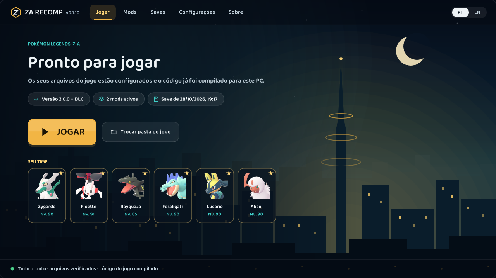

<div align="center">


# ZA Recomp

**Um port nativo para PC de *Pokémon Legends: Z-A*, feito por recompilação estática.**

[English](README.md) · **Português (Brasil)**

[Download](https://github.com/Hexveil404/PokeZ-ARecomp/releases/latest) ·
[Relatar um bug](https://github.com/Hexveil404/PokeZ-ARecomp/issues) ·
[Port para macOS (MonZaMac)](https://github.com/lucabravi/MonZaMac)

</div>

---

O ZA Recomp transforma o código do jogo do Nintendo Switch em um programa nativo do Windows. O código ARM64 é
traduzido antecipadamente para C e compilado para x86-64 no seu PC, e o sistema operacional e a GPU (NVN) do Switch
são reimplementados sobre Vulkan. Nenhum emulador roda enquanto você joga.

Ele é baseado no **[LAS Recomp](https://github.com/peiikai/LASRecomp)**, do Peiikai, o recompilador estático feito
para *The Legend of Zelda: Link's Awakening*.

> [!IMPORTANT]
> **Você precisa da sua própria cópia do jogo.** O ZA Recomp não inclui arquivos, código, assets nem fontes do jogo.

## Conteúdo

- [Imagens](#imagens)
- [Recursos](#recursos)
- [Requisitos](#requisitos)
- [Instalação](#instalação) ([DLC Mega Dimension](#dlc-mega-dimension), [Linux (experimental)](#linux-experimental))
- [Controles](#controles)
- [Saves](#saves)
- [Mods](#mods)
- [Solução de problemas](#solução-de-problemas)
- [Compilando o código-fonte](#compilando-o-código-fonte)
- [Créditos](#créditos)
- [Aviso legal](#aviso-legal)

## Imagens

| | |
|---|---|
|  |  |
| Lumiose City a 60 fps | A tela inicial, com o seu time |
|  |  |
| O menu do jogo (com mod de tradução) | A mochila |

## Recursos

**Desempenho**
- 60 fps na velocidade normal do jogo, ou 30 fps como no Switch
- Resolução interna de 25% até 4x (1x = 1080p), além de Dinâmica e Igual à tela
- Opção de ritmo dos quadros (Suave / Padrão) para telas em que o fps parece irregular

**Gráficos** (todos opcionais, desligados por padrão)
- Upscaling com AMD FSR 1, anti-aliasing com SMAA ou AMD FSR 2 (temporal), nitidez
- Saída HDR (HDR10 / scRGB)
- Oclusão de ambiente (GTAO), luz indireta (GI em espaço de tela) e reflexos na água
- Sombras mais nítidas (mapa de sombras em resolução maior) e filtragem de texturas de alta qualidade
- Pacotes de texturas HD (`textures/hd/`)

**Controles**
- Qualquer controle do SDL3: Xbox, PlayStation (DualShock 4 / DualSense), Switch Pro, Steam Deck e outros
- Teclado e mouse, com câmera pelo mouse
- Todos os botões e teclas podem ser remapeados; os ícones dos botões seguem o seu controle (Xbox, PlayStation,
  Nintendo, Steam Deck, teclado)
- Golpes por posição e encaixe do analógico direito no eixo

**Tela inicial**
- Prepara o jogo a partir dos seus arquivos e compila uma única vez no seu PC
- Gerenciador de mods (mods de romfs), importação / exportação de saves e backups
- Inglês e português (Brasil)

## Requisitos

| | |
|---|---|
| **Sistema** | Windows 10 (1903 ou mais novo) ou Windows 11, 64 bits. Linux x86-64: experimental, veja [Linux](#linux-experimental) |
| **CPU** | x86-64 com AVX2 (2013 ou mais nova). CPUs mais antigas com SSE4.2 também funcionam, mas compilam e rodam mais devagar |
| **GPU** | Vulkan 1.2 ou mais novo (1.3 recomendado), com driver atualizado |
| **RAM** | 8 GB (16 GB recomendado) |
| **Disco** | Cerca de 12 GB livres |
| **Jogo** | Pokémon Legends: Z-A **1.0.0, 2.0.0 ou 2.0.2**, com ou sem a DLC *Mega Dimension* |

O Linux roda nativamente (x86-64, sem Wine nem Proton) em uma versão **experimental**: veja [Linux (experimental)](#linux-experimental).
No Mac, use o [MonZaMac](https://github.com/lucabravi/MonZaMac), do
[@lucabravi](https://github.com/lucabravi), um port nativo para macOS baseado neste projeto.

## Instalação

1. Baixe o `ZA-Recomp-windows.zip` mais recente em [Releases](https://github.com/Hexveil404/PokeZ-ARecomp/releases/latest)
   e extraia em uma pasta à sua escolha (por exemplo `C:\Jogos\ZA Recomp`).
2. Deixe a sua própria cópia do jogo em uma pasta, de um destes jeitos:
   - **Jogo extraído**: as pastas `exefs` e `romfs`, como um emulador ou o seu Switch extraem. Não precisa de keys.
   - **Dump**: o jogo base (`.xci` ou `.nsp`), se quiser a atualização e a DLC *Mega Dimension* (`.nsp`), junto com o `prod.keys` do seu
     próprio Switch.
3. Abra o `lasrecomp.exe`. Na tela inicial, escolha essa pasta (ou arraste para a janela) e clique em
   **Preparar o jogo**.
4. Os arquivos do jogo são lidos e o código é compilado para o seu PC. Isso leva de 10 a 30 minutos, dependendo da CPU,
   e acontece **uma única vez**. Depois de uma atualização do ZA Recomp, só o que mudou é compilado de novo.
5. Clique em **Jogar**.

Os seus arquivos nunca são alterados. Se quiser, importe as fontes do seu console na tela inicial
(**Configurações > Arquivos**) para o texto e os ícones de botões originais; sem elas, é usada uma fonte substituta.

### DLC Mega Dimension

A DLC é suportada pelo caminho do **dump** (as pastas extraídas `exefs` / `romfs` não incluem ela):

1. Coloque estes arquivos juntos em uma pasta: o jogo base (`.xci` ou `.nsp`), a **atualização** (`.nsp`, versão 2.0.0
   ou mais nova - o conteúdo da DLC vem com ela), a **DLC** (`.nsp`) e o `prod.keys` do seu Switch (e o `title.keys`
   se a tela inicial pedir).
2. Escolha essa pasta na tela inicial e clique em **Preparar o jogo**.
3. A tela inicial mostra **+ DLC** ao lado da versão do jogo quando ela foi encontrada.

Já preparou o jogo sem a DLC? Clique em **Trocar pasta do jogo**, escolha a pasta de novo com a DLC junto e prepare de
novo. Os seus saves e configurações são mantidos.

### Linux (experimental)

O ZA Recomp roda nativamente no Linux x86-64, sem Wine nem Proton. Ainda não há download pronto para Linux: você
compila uma vez na sua máquina (os scripts fazem tudo) e depois prepara o jogo como no Windows.

**Testado até agora:** Linux Mint 22.3 com GPU integrada Intel UHD e 8 GB de RAM, Pokémon Legends: Z-A 2.0.2. Cutscenes,
áudio e movimentação funcionam; nessa GPU integrada as cenas 3D rodam a cerca de 15-26 fps (menus a 60). Controles,
saves, mods, outras GPUs e sessões longas ainda não foram testados - relatos são bem-vindos.

**Precisa de:** uma distribuição 64 bits com glibc 2.35 ou mais nova (Ubuntu 22.04+, Linux Mint 21+, Debian 12, Fedora,
Arch...), driver Vulkan 1.3 (Mesa ou o da NVIDIA), CPU com AVX2, 8 GB de RAM e cerca de 12 GB livres. Os comandos abaixo
são para Ubuntu / Linux Mint / Debian; nas outras distribuições os pacotes têm nomes equivalentes (no Debian, o
`dotnet-sdk-8.0` vem do repositório de pacotes da Microsoft).

1. Instale as ferramentas e bibliotecas de compilação (uma vez):

   ```bash
   sudo apt install git clang lld cmake ninja-build nasm pkg-config python3-venv curl patchelf dotnet-sdk-8.0 \
       libx11-dev libxext-dev libxrandr-dev libxcursor-dev libxi-dev libxss-dev libxfixes-dev libxtst-dev \
       libxkbcommon-dev libwayland-dev wayland-protocols libdecor-0-dev libegl-dev libdrm-dev libgbm-dev \
       libpulse-dev libasound2-dev libpipewire-0.3-dev libdbus-1-dev libudev-dev libibus-1.0-dev libvulkan-dev
   ```

2. Baixe o código e gere o AppImage (na primeira vez ele baixa e compila as bibliotecas, o que demora um pouco):

   ```bash
   git clone https://github.com/Hexveil404/PokeZ-ARecomp.git
   cd PokeZ-ARecomp
   tools/za/dist-linux.sh
   ```

   O resultado é `build/dist/ZA Recomp-<versão>-linux-x86_64.AppImage`. Copie para onde quiser.

3. Abra o AppImage (se precisar, dê `chmod +x` antes). Na tela inicial, escolha a pasta do jogo (`exefs` + `romfs`
   extraídos, ou os seus `.xci` / `.nsp` com o seu `prod.keys`), clique em **Preparar o jogo** e depois em **Jogar**,
   como no Windows. Configurações, saves e arquivos do jogo ficam em `~/.local/share/zarecomp`.

Se a preparação pela tela inicial falhar, há um caminho manual, que é o testado de ponta a ponta até agora. Troque os
caminhos pelos dos seus arquivos:

```bash
tools/za/build-linux.sh                       # o programa
build/linux/x86_64/zaimport/zaimport ~/caminho/prod.keys extracted ~/caminho/base.nsp ~/caminho/update.nsp
GAME=1 JOBS=3 tools/za/build-linux.sh         # compila o código do jogo: cerca de 20 minutos, uma vez
build/linux/x86_64/za/lasrecomp extracted --play
```

Numa GPU integrada, baixe a **Resolução** no menu F1 para o jogo rodar mais liso. Mais detalhes, outras opções e
problemas conhecidos: [docs/linux.md](docs/linux.md#za-recomp-on-linux-native-x86-64).

## Controles

Aperte **F1** no jogo (ou abra **Configurações** na tela inicial) para o menu de configurações: fps, resolução,
opções gráficas, controles, ícones dos botões e mais. As configurações são salvas na hora no `larecomp.ini`.

| Teclado (padrão) | Switch |
|---|---|
| W A S D | Analógico esquerdo |
| Setas | Direcional |
| K / J / L / I | A / B / X / Y |
| Q / E | L / R |
| 1 / 3 | ZL / ZR |
| Enter / Backspace | + / − |
| F / Numpad 0 | Clique do analógico esquerdo / direito |
| Numpad 8 / 4 / 5 / 6 | Analógico direito |
| Mouse | Câmera; botão esquerdo ZR (arremessar), direito ZL (mirar) |

| Tecla | Ação |
|---|---|
| F1 / Esc | Menu de configurações |
| F11 / Alt+Enter | Tela cheia |
| F10 | Captura de tela (`screenshots/`) |

Todos os comandos podem ser trocados em **Configurações > Controles > Configurar comandos**.

## Saves

Os saves são os arquivos do próprio jogo, guardados em `save/save_0/` ao lado do `lasrecomp.exe`. São os mesmos do
Switch, então passam de um para o outro sem conversão. A página **Saves** da tela inicial importa, exporta e restaura
backups; toda importação guarda o seu save anterior como backup.

- **Switch → PC**: faça o backup do save com o **JKSV** no Switch, copie a pasta do backup (ela tem um arquivo chamado
  `main`) para o PC e importe na página **Saves**.
- **PC → Switch**: exporte o save, copie os arquivos para uma pasta de backup do JKSV no cartão SD e restaure com o JKSV.
- **Versões do jogo**: um save da 2.0.x precisa do jogo preparado com a atualização 2.0.x. A versão 2.0.0 converte um
  save da 1.0.0 na primeira vez que salva, e o save convertido não abre mais na 1.0.0. Guarde um backup.

## Mods

Mods que trocam arquivos do jogo (uma pasta `romfs`): traduções, texturas, modelos. Instale pela página **Mods** (ou
arraste o mod para a janela); eles ficam em `mods/`. Quando dois mods trocam o mesmo arquivo, vale o que está mais
acima na lista.

Mods que mudam o código do jogo (`exefs`, patches IPS, plugins de cheats) não funcionam num jogo recompilado.

## Solução de problemas

- **Logs**: cada sessão grava `logs/play.log` ao lado do exe (o anterior fica como `logs/play-anterior.log`). Anexe esse
  arquivo em qualquer relato de bug.
- **Erros do driver de vídeo** ("Your graphics driver crashed", falha de página da GPU): abra
  **Configurações > Vídeo > Compatibilidade** e desligue as opções uma de cada vez. Elas valem a partir do próximo
  início.
- **Fps baixo**: diminua a resolução interna ou ligue a resolução Dinâmica, e desligue os recursos gráficos opcionais.
- **Relatar um bug**: [abra uma issue](https://github.com/Hexveil404/PokeZ-ARecomp/issues) com a sua GPU, a versão do
  driver, a versão do jogo e o `logs/play.log`.

## Compilando o código-fonte

O ZA Recomp compila no Windows com o MSYS2 (UCRT64: clang, SDL3, FFmpeg, shaderc, headers do Vulkan) e Python 3. Veja
[docs/BUILD-windows.md](docs/BUILD-windows.md) para a configuração. `bash tools/za/dist.sh` monta a pasta da release
(`build/dist-za/ZA Recomp/`; `ZIP=1` para o zip), que vai sem nenhum código do jogo: a tela inicial compila no PC do
jogador.

Onde ficam as coisas: o recompilador em `tools/`, o runtime em `runtime/` (serviços HLE, a implementação do NVN em
`runtime/nvn/`, o backend Vulkan em `runtime/nvn/vulkan/` e o tradutor de shaders Maxwell em `runtime/nvn/maxwell/`), e
as ferramentas do Pokémon Z-A em `tools/za/`.

Contribuições são bem-vindas. Nunca faça commit nem anexe arquivos da Nintendo (arquivos do jogo, dados extraídos,
código gerado, fontes, saves).

## Créditos

- **[Peiikai](https://github.com/peiikai)**: criador do [LAS Recomp](https://github.com/peiikai/LASRecomp), o
  recompilador estático, o runtime, os renderizadores e o tradutor de shaders em que este port se baseia.
- **[Hexveil404](https://github.com/Hexveil404)**: o port de Pokémon Legends: Z-A.
- **Contribuidores do ZA Recomp**: [@Primus92](https://github.com/Primus92), [@Atterax](https://github.com/Atterax),
  [@wimw85](https://github.com/wimw85), [@lucabravi](https://github.com/lucabravi) e todos que relataram problemas e
  testaram builds.
- **Contribuidores do LAS Recomp**: veja [docs/LASRecomp-README.md](docs/LASRecomp-README.md#credits).
- **[Ryujinx](https://github.com/Ryujinx/Ryujinx)**, usado como referência de comportamento (nenhum código copiado),
  **[envytools](https://github.com/envytools/envytools)** e **[Switchbrew](https://switchbrew.org)** pela documentação
  da GPU e do sistema.
- **Bibliotecas**: [SDL 3](https://libsdl.org), [FFmpeg](https://ffmpeg.org), [Dear ImGui](https://github.com/ocornut/imgui),
  [Vulkan Memory Allocator](https://github.com/GPUOpen-LibrariesAndSDKs/VulkanMemoryAllocator),
  [shaderc](https://github.com/google/shaderc), [SMAA](https://github.com/iryoku/smaa),
  [AMD FidelityFX FSR 1 e FSR 2](https://github.com/GPUOpen-Effects), [XeGTAO](https://github.com/GameTechDev/XeGTAO),
  [LibHac](https://github.com/Thealexbarney/LibHac), [Zig](https://ziglang.org) e as outras listadas em
  [docs/LASRecomp-README.md](docs/LASRecomp-README.md#license).

## Aviso legal

O ZA Recomp é um projeto de fãs. Não é afiliado, endossado nem patrocinado pela Nintendo, Game Freak, Creatures ou
The Pokémon Company. *Pokémon* e *Pokémon Legends: Z-A* são marcas registradas dos seus respectivos donos. Nenhum
arquivo, código, asset ou fonte do jogo está incluído; você precisa fornecer a sua própria cópia do jogo, obtida
legalmente.

O código é distribuído sob a [Licença MIT](LICENSE) (LAS Recomp © Peiikai). Componentes de terceiros mantêm as suas
próprias licenças; veja [docs/LASRecomp-README.md](docs/LASRecomp-README.md#license).
