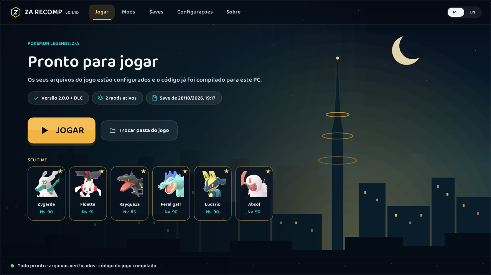

<div align="center">


# ZA Recomp

**Um port nativo para PC de *Pokémon Legends: Z-A*, feito por recompilação estática.**

[English](README.md) · **Português (Brasil)**

[Download](https://github.com/Hexveil404/PokeZ-ARecomp/releases/latest) ·
[Relatar um bug](https://github.com/Hexveil404/PokeZ-ARecomp/issues) ·
[Port para macOS (MonZaMac)](https://github.com/lucabravi/MonZaMac)

</div>

---

O ZA Recomp transforma o código do jogo do Nintendo Switch em um programa nativo do Windows. O código ARM64 é
traduzido antecipadamente para C e compilado para x86-64 no seu PC, e o sistema operacional e a GPU (NVN) do Switch
são reimplementados sobre Vulkan. Nenhum emulador roda enquanto você joga.

Ele é baseado no **[LAS Recomp](https://github.com/peiikai/LASRecomp)**, do Peiikai, o recompilador estático feito
para *The Legend of Zelda: Link's Awakening*.

> [!IMPORTANT]
> **Você precisa da sua própria cópia do jogo.** O ZA Recomp não inclui arquivos, código, assets nem fontes do jogo.

## Conteúdo

- [Imagens](#imagens)
- [Recursos](#recursos)
- [Requisitos](#requisitos)
- [Instalação](#instalação) ([DLC Mega Dimension](#dlc-mega-dimension), [Linux (experimental)](#linux-experimental))
- [Controles](#controles)
- [Saves](#saves)
- [Mods](#mods)
- [Multiplayer (teste)](#multiplayer-teste)
- [Solução de problemas](#solução-de-problemas)
- [Compilando o código-fonte](#compilando-o-código-fonte)
- [Ferramentas de desenvolvimento](#ferramentas-de-desenvolvimento)
- [Créditos](#créditos)
- [Aviso legal](#aviso-legal)

## Imagens

| | |
|---|---|
|  |  |
| Lumiose City a 60 fps | A tela inicial, com o seu time |
|  |  |
| O menu do jogo (com mod de tradução) | A mochila |

## Recursos

**Desempenho**
- 60 fps na velocidade normal do jogo, ou 30 fps como no Switch
- Resolução interna de 25% até 4x (1x = 1080p), além de Dinâmica e Igual à tela
- Opção de ritmo dos quadros (Suave / Padrão) para telas em que o fps parece irregular

**Gráficos** (todos opcionais, desligados por padrão)
- Upscaling com AMD FSR 1, anti-aliasing com SMAA ou AMD FSR 2 (temporal), nitidez
- AMD FSR 4.1.2 temporal opcional no Linux com um provedor FidelityFX fornecido pelo usuário (RDNA4; veja
  [docs/linux.md](docs/linux.md#fsr-412-temporal-upscaling-optional-linux))
- Saída HDR (HDR10 / scRGB)
- Oclusão de ambiente (GTAO), luz indireta (GI em espaço de tela) e reflexos na água
- Sombras mais nítidas (mapa de sombras em resolução maior) e filtragem de texturas de alta qualidade
- Pacotes de texturas HD (`textures/hd/`)
- API gráfica (Windows): Vulkan, ou DirectX 12 para placas cujo driver Vulkan trava o jogo (veja
  [DirectX 12](#directx-12))

**Controles**
- Qualquer controle do SDL3: Xbox, PlayStation (DualShock 4 / DualSense), Switch Pro, Steam Deck e outros
- Teclado e mouse, com câmera pelo mouse
- Todos os botões e teclas podem ser remapeados; os ícones dos botões seguem o seu controle (Xbox, PlayStation,
  Nintendo, Steam Deck, teclado)
- Golpes por posição e encaixe do analógico direito no eixo

**Tela inicial**
- Prepara o jogo a partir dos seus arquivos e compila uma única vez no seu PC
- Gerenciador de mods (mods de romfs), importação / exportação de saves e backups
- Inglês e português (Brasil)

## Requisitos

| | |
|---|---|
| **Sistema** | Windows 10 (1903 ou mais novo) ou Windows 11, 64 bits. Linux x86-64: experimental, veja [Linux](#linux-experimental) |
| **CPU** | x86-64 com AVX2 (2013 ou mais nova). CPUs mais antigas com SSE4.2 também funcionam, mas compilam e rodam mais devagar |
| **GPU** | Vulkan 1.2 ou mais novo (1.3 recomendado), com driver atualizado. Com a opção DirectX 12: uma placa DirectX 12 (feature level 11_0, shader model 6.0) |
| **RAM** | 8 GB (16 GB recomendado) |
| **Disco** | Cerca de 12 GB livres |
| **Jogo** | Pokémon Legends: Z-A **1.0.0, 2.0.0 ou 2.0.2**, com ou sem a DLC *Mega Dimension*; um `.nup` cuja atualização seja uma dessas também funciona |

O Linux roda nativamente (x86-64, sem Wine nem Proton) em uma versão **experimental**: veja [Linux (experimental)](#linux-experimental).
No Mac, use o [MonZaMac](https://github.com/lucabravi/MonZaMac), do
[@lucabravi](https://github.com/lucabravi), um port nativo para macOS baseado neste projeto.

## Instalação

1. Baixe o `ZA-Recomp-windows.zip` mais recente em [Releases](https://github.com/Hexveil404/PokeZ-ARecomp/releases/latest)
   e extraia em uma pasta à sua escolha (por exemplo `C:\Jogos\ZA Recomp`).
2. Deixe a sua própria cópia do jogo em uma pasta, de um destes jeitos:
   - **Jogo extraído**: as pastas `exefs` e `romfs`, como um emulador ou o seu Switch extraem. Não precisa de keys.
   - **Dump**: o jogo base (`.xci`, `.nsp` ou `.nup`), se quiser a atualização e a DLC *Mega Dimension* (`.nsp`).
     Pacotes `.xci` / `.nsp` precisam do `prod.keys` do seu próprio Switch; um `.nup` não precisa de keys.
3. Abra o `lasrecomp.exe`. Na tela inicial, escolha essa pasta (ou arraste para a janela) e clique em
   **Preparar o jogo**.
4. Os arquivos do jogo são lidos e o código é compilado para o seu PC. Isso leva de 10 a 30 minutos, dependendo da CPU,
   e acontece **uma única vez**. Depois de uma atualização do ZA Recomp, só o que mudou é compilado de novo.
5. Clique em **Jogar**.

Os seus arquivos nunca são alterados. Se quiser, importe as fontes do seu console na tela inicial
(**Configurações > Arquivos**) para o texto e os ícones de botões originais; sem elas, é usada uma fonte substituta.

### DLC Mega Dimension

A DLC é suportada pelo caminho do **dump** (as pastas extraídas `exefs` / `romfs` não incluem ela); um `.nup` também pode ser usado:

1. Coloque estes arquivos juntos em uma pasta: o jogo base (`.xci`, `.nsp` ou `.nup`), a **atualização** (opcional
   para um `.nup`; para `.xci` / `.nsp`, a `.nsp` versão 2.0.0 ou mais nova - o conteúdo da DLC vem com ela), a **DLC**
   (`.nsp`) e, para `.xci` / `.nsp`, o `prod.keys` do seu Switch (e o `title.keys` se a tela inicial pedir).
2. Escolha essa pasta na tela inicial e clique em **Preparar o jogo**.
3. A tela inicial mostra **+ DLC** ao lado da versão do jogo quando ela foi encontrada.

### Nintendo Switch 2 Edition e `.nup`

Um `.nup` (o pacote usado por dumps mais novos do Switch 2) pode ser escolhido diretamente: coloque o `.nup` em uma pasta
e escolha essa pasta na tela inicial. **Um `.nup` não precisa de `prod.keys`.** A tela inicial lê as árvores de base e
atualização; use a atualização **2.0.2** para o Lumiose Online. O add-on de upgrade da Switch 2 Edition
(`0100F43008C45001`) é instalado para o jogo ver o direito (o RomFS dele é um placeholder), e as opções de 60 fps /
resolução / câmera do port fazem a parte visual da edição. A DLC *Mega Dimension* é separada: coloque a `.nsp` da
DLC 2 (`0100F43008C45002`) e o `prod.keys` / `title.keys` na mesma pasta; a tela inicial mostra **+ DLC**. Os dados do
jogo ficam em uma pasta `romfs/`, então os ícones dos botões e o layout de batalha do Xbox são feitos dela como no jogo
extraído.

Já preparou o jogo sem a DLC? Clique em **Trocar pasta do jogo**, escolha a pasta de novo com a DLC junto e prepare de
novo. Os seus saves e configurações são mantidos.

### Linux (experimental)

O ZA Recomp roda nativamente no Linux x86-64, sem Wine nem Proton. Quando a release tiver arquivos para Linux, escolha
um: `zarecomp_<versão>_amd64.deb` (Ubuntu / Linux Mint / Debian: `sudo apt install ./zarecomp_<versão>_amd64.deb`, depois
**ZA Recomp** no menu ou `zarecomp` no terminal), o `.AppImage` (dê `chmod +x` e abra) ou o `.zip` (descompacte onde
quiser e abra `./zarecomp`), e prepare o jogo como no passo 3 abaixo. Senão, você compila uma vez na sua máquina (os
scripts fazem tudo).

**Testado até agora:** Linux Mint 22.3 com GPU integrada Intel UHD e 8 GB de RAM, Pokémon Legends: Z-A 2.0.2. Cutscenes,
áudio e movimentação funcionam; nessa GPU integrada as cenas 3D rodam a cerca de 15-26 fps (menus a 60). Controles,
saves, mods, outras GPUs e sessões longas ainda não foram testados - relatos são bem-vindos.

**Precisa de:** uma distribuição 64 bits com glibc 2.35 ou mais nova (Ubuntu 22.04+, Linux Mint 21+, Debian 12, Fedora,
Arch...), driver Vulkan 1.3 (Mesa ou o da NVIDIA), CPU com AVX2, 8 GB de RAM e cerca de 12 GB livres. Os comandos abaixo
são para Ubuntu / Linux Mint / Debian; nas outras distribuições os pacotes têm nomes equivalentes (no Debian, o
`dotnet-sdk-8.0` vem do repositório de pacotes da Microsoft).

1. Instale as ferramentas e bibliotecas de compilação (uma vez):

   ```bash
   sudo apt install git clang lld cmake ninja-build nasm pkg-config python3-venv curl patchelf dotnet-sdk-8.0 \
       libx11-dev libxext-dev libxrandr-dev libxcursor-dev libxi-dev libxss-dev libxfixes-dev libxtst-dev \
       libxkbcommon-dev libwayland-dev wayland-protocols libdecor-0-dev libegl-dev libdrm-dev libgbm-dev \
       libpulse-dev libasound2-dev libpipewire-0.3-dev libdbus-1-dev libudev-dev libibus-1.0-dev libvulkan-dev
   ```

2. Baixe o código e gere o AppImage (na primeira vez ele baixa e compila as bibliotecas, o que demora um pouco):

   ```bash
   git clone https://github.com/Hexveil404/PokeZ-ARecomp.git
   cd PokeZ-ARecomp
   tools/za/dist-linux.sh
   ```

   O resultado é `build/dist/ZA Recomp-<versão>-linux-x86_64.AppImage` (e os mesmos arquivos em `.zip` e `.deb`).
   Copie para onde quiser.

3. Abra o AppImage (se precisar, dê `chmod +x` antes). Na tela inicial, escolha a pasta do jogo (`exefs` + `romfs`
   extraídos, ou os seus `.xci` / `.nsp` com o seu `prod.keys`), clique em **Preparar o jogo** e depois em **Jogar**,
   como no Windows. Configurações, saves e arquivos do jogo ficam em `~/.local/share/zarecomp`.

Se a preparação pela tela inicial falhar, há um caminho manual, que é o testado de ponta a ponta até agora. Troque os
caminhos pelos dos seus arquivos:

```bash
tools/za/build-linux.sh                       # o programa
build/linux/x86_64/zaimport/zaimport ~/caminho/prod.keys extracted ~/caminho/base.nsp ~/caminho/update.nsp
GAME=1 JOBS=3 tools/za/build-linux.sh         # compila o código do jogo: cerca de 20 minutos, uma vez
build/linux/x86_64/za/lasrecomp extracted --play
```

Numa GPU integrada, baixe a **Resolução** no menu F1 para o jogo rodar mais liso. Mais detalhes, outras opções e
problemas conhecidos: [docs/linux.md](docs/linux.md#za-recomp-on-linux-native-x86-64).

## Controles

Aperte **F1** no jogo (ou abra **Configurações** na tela inicial) para o menu de configurações: fps, resolução,
opções gráficas, controles, ícones dos botões e mais. As configurações são salvas na hora no `larecomp.ini`.

Na primeira vez que abre, o ZA Recomp escolhe a resolução e o fps para o seu PC (pela placa de vídeo, CPU e RAM); quem
vem de uma versão anterior recebe uma pergunta única na tela inicial. Com 60 fps, **Cair para 30 fps quando preciso**
(desligado por padrão) volta para 30 fps quando o PC não segura 60, em vez de ficar em câmera lenta.

| Teclado (padrão) | Switch |
|---|---|
| W A S D | Analógico esquerdo |
| Setas | Direcional |
| K / J / L / I | A / B / X / Y |
| Q / E | L / R |
| 1 / 3 | ZL / ZR |
| Enter / Backspace | + / − |
| F / Numpad 0 | Clique do analógico esquerdo / direito |
| Numpad 8 / 4 / 5 / 6 | Analógico direito |
| Mouse | Câmera; botão esquerdo ZR (arremessar), direito ZL (mirar) |

| Tecla | Ação |
|---|---|
| F1 / Esc | Menu de configurações |
| F11 / Alt+Enter | Tela cheia |
| F10 | Captura de tela (`screenshots/`) |

Todos os comandos podem ser trocados em **Configurações > Controles > Configurar comandos**.

## Saves

Os saves são os arquivos do próprio jogo, guardados em `save/save_0/` ao lado do `lasrecomp.exe`. São os mesmos do
Switch, então passam de um para o outro sem conversão. A página **Saves** da tela inicial importa, exporta e restaura
backups; toda importação guarda o seu save anterior como backup.

- **Switch → PC**: faça o backup do save com o **JKSV** no Switch, copie a pasta do backup (ela tem um arquivo chamado
  `main`) para o PC e importe na página **Saves**.
- **PC → Switch**: exporte o save, copie os arquivos para uma pasta de backup do JKSV no cartão SD e restaure com o JKSV.
- **Versões do jogo**: um save da 2.0.x precisa do jogo preparado com a atualização 2.0.x. A versão 2.0.0 converte um
  save da 1.0.0 na primeira vez que salva, e o save convertido não abre mais na 1.0.0. Guarde um backup.

## Mods

Mods que trocam arquivos do jogo (uma pasta `romfs`): traduções, texturas, modelos. Instale pela página **Mods** (ou
arraste o mod para a janela); eles ficam em `mods/`. Quando dois mods trocam o mesmo arquivo, vale o que está mais
acima na lista.

Mods que mudam o código do jogo (`exefs`, patches IPS, plugins de cheats) não funcionam num jogo recompilado.

## Multiplayer (teste)

> **Este recurso é um teste.** Pode não conectar em todas as redes, e pode mudar ou ser removido numa versão futura.
> Conte pra gente como funcionou para você.

O **Link Play** de Pokémon Legends Z-A (trocas e batalhas privadas) funciona entre duas cópias do ZA Recomp, sem
servidor e sem conta.

**Na mesma rede (rede de casa, ou uma rede virtual como Radmin VPN / ZeroTier / Hamachi):** nada para configurar. No
jogo, **Link Play > Nearby Players** encontra o outro PC como encontraria um Switch por perto. Depois é só usar o código
de troca ou a senha da sala do próprio jogo, como no console.

**Pela internet:**
1. Os dois jogadores abrem **F1 > Online** no jogo e copiam o **Seu código** (A / clique copia).
2. Mandem para o amigo (WhatsApp, Discord...) e colem o código dele em **Colar código do amigo** (ele é lido da área
   de transferência). Os dois precisam colar o código um do outro.
3. Esperem aparecer **Situação: Conectado**, normalmente em até um minuto. Aí é só usar **Link Play > Nearby Players**
   no jogo, como acima.

Se aparecer **Não conectou**, uma das duas redes bloqueia conexões diretas (algumas redes de celular e roteadores de
empresa). Uma rede virtual (Radmin VPN, ZeroTier, Hamachi) resolve, e aí nem precisa de código.

### Como funciona

- **Comunicação local, emulada:** a comunicação local sem fio do Switch e os sockets de rede do jogo são recriados em
  cima de UDP comum no seu PC (portas 47810-47817 na rede local). O jogo manda e recebe os mesmos dados que mandaria
  num console.
- **Códigos de conexão:** o seu código leva o seu endereço de internet público e a porta, como são vistos de fora
  (descobertos por servidores STUN públicos: Google, Cloudflare), mais um **token de sessão** aleatório criado quando o
  jogo abre.
- **Sem servidor no meio:** depois que os dois colam os códigos, os dois jogos mandam pacotes direto um para o outro
  até os dois roteadores deixarem passar ("hole punching"). Eles tentam em horários fixos do relógio, usando a hora de
  servidores NTP públicos (Cloudflare, Google, pool.ntp.org), então o relógio dos PCs não precisa estar certo. Não
  precisa abrir porta nem mexer no roteador.
- **O que é enviado:** só o que o próprio jogo manda durante o Link Play (os dados da troca ou da batalha, como no
  console). O seu save, os arquivos do jogo e as suas keys nunca saem do seu PC.

### Segurança

- **O seu código mostra o seu IP.** Compartilhe só com quem vai jogar com você, como em qualquer jogo de conexão direta
  (peer-to-peer). O código muda toda vez que o jogo abre, e nada fica escutando na internet depois que o jogo fecha.
- **Só amigos:** pela internet, o jogo só aceita jogadores cujo código você colou. Cada pacote é assinado (HMAC-SHA1)
  com uma chave feita dos tokens de sessão dos dois jogadores. Pacotes de qualquer outra pessoa, ou que falham na
  conferência, são descartados antes de chegar ao jogo, e também enxurradas (mais de 4000 pacotes por segundo).
- **Assinado, não criptografado:** ninguém de fora consegue injetar ou alterar o que você manda, mas os dados da troca
  não ficam escondidos de quem consegue ver o seu tráfego (a sua rede ou o seu provedor). São os dados da troca do
  próprio jogo, nada pessoal.
- **Mesma rede:** o jogo local não é assinado, igual à comunicação local de um Switch. Qualquer um na sua rede local ou
  rede virtual vê a sua sala, e quem entra é decidido pelo código de troca ou pela senha da sala do próprio jogo.
- **Confie em quem joga com você:** o jogo do outro jogador manda dados que o seu jogo processa, como num console.
  Jogue com pessoas que você conhece.
- Sem contas e sem dados enviados para nós: o projeto não tem servidor nenhum. Os únicos serviços de fora usados são os
  servidores públicos de STUN e NTP citados acima, que veem o seu endereço e mais nada.

### Por que funciona desse jeito (e por que não tem modo ranqueado)

- **Batalhas ranqueadas, partidas com desconhecidos e trocas "Faraway Players" precisam de um servidor** ligado o
  tempo todo: para achar adversários que você não conhece, guardar o ranking e conferir os resultados. No jogo original
  isso roda nos servidores da Nintendo, que um port para PC não pode (nem deve) usar.
- **O ZA Recomp não tem servidor e não pede doação nem qualquer apoio financeiro.** Manter um servidor público custa
  dinheiro todo mês e exige alguém cuidando dele e da segurança, então não existe modo ranqueado nem de partidas
  aleatórias, e por enquanto não está nos planos.
- **O que já dá para fazer hoje:** trocas e batalhas privadas com amigos, de jogo para jogo, pela internet ou na mesma
  rede, seguindo os passos acima. Não há nada no meio que possa cair, e ninguém além do seu amigo participa.

## DirectX 12

O ZA Recomp normalmente roda no driver **Vulkan** da sua placa de vídeo. No Windows ele também pode rodar o mesmo
renderizador no driver **DirectX 12** da placa, o que ajuda quando o driver Vulkan trava ou desenha o jogo errado
(algumas placas AMD).

- **Como ligar**: **F1 > Tela > API gráfica: DirectX 12** no jogo. Vale a partir do próximo início. Se o DirectX 12 não iniciar, o próximo início volta sozinho para o Vulkan.
- **Como funciona**: usa o Dozen do [Mesa](https://mesa3d.org) (uma implementação de Vulkan sobre o Direct3D 12),
  compilado com as correções para este jogo e incluído na pasta `dx12`, mais o Agility SDK do Direct3D 12 na pasta
  `D3D12`. Mantenha as duas pastas ao lado do `lasrecomp.exe`.
- **Situação**: novo e experimental. Numa RTX 4060 Ti ele desenha a mesma imagem que o Vulkan, na mesma velocidade;
  ainda não foi testado em placas AMD nem Intel - conte pra gente como roda na sua.
- **Primeiro início**: o primeiro início no DirectX 12 prepara uma vez os shaders que você já viu no jogo (pode levar
  alguns minutos); depois disso leva menos de um segundo.
- **Logs**: o `logs/play.log` tem uma linha `graphics API: DirectX 12 (Dozen, ...)` quando ele está ligado.

## Solução de problemas

- **Logs**: cada sessão grava `logs/play.log` ao lado do exe (o anterior fica como `logs/play-anterior.log`). Anexe esse
  arquivo em qualquer relato de bug.
- **Erros do driver de vídeo** ("Your graphics driver crashed", falha de página da GPU): abra
  **Configurações > Vídeo > Compatibilidade** e desligue as opções uma de cada vez. Elas valem a partir do próximo
  início.
- **O jogo trava no Vulkan** (comum em placas AMD): experimente **F1 > Tela > API gráfica: DirectX 12**
  ([DirectX 12](#directx-12)).
- **AMD Radeon RX 9000 (RDNA4) com Mesa 27.0-devel**: versões antigas do mesa-git travavam dentro do
  `libvulkan_radeon` no primeiro desenho porque o RADV 27 só inicializa o cache de epilogs do PS quando um bit de
  extensão de estado dinâmico está ligado; no Vulkan 1.3 o estado dinâmico estendido 1 é do núcleo, então nenhum bit
  era ligado. O renderizador agora ativa o recurso promovido `VK_EXT_extended_dynamic_state` em dispositivos RADV 1.3,
  o que faz o RADV inicializar o cache. Mesa 26.2.6 (estável) e o mesa-git atual funcionam; não é preciso voltar para
  o driver estável. Veja [docs/linux.md](docs/linux.md#amd-rdna4-and-mesa-270-devel).
- **Fps baixo**: diminua a resolução interna ou ligue a resolução Dinâmica, e desligue os recursos gráficos opcionais.
- **Relatar um bug**: [abra uma issue](https://github.com/Hexveil404/PokeZ-ARecomp/issues) com a sua GPU, a versão do
  driver, a versão do jogo e o `logs/play.log`.

## Compilando o código-fonte

O ZA Recomp compila no Windows com o MSYS2 (UCRT64: clang, SDL3, FFmpeg, shaderc, headers do Vulkan) e Python 3. Veja
[docs/BUILD-windows.md](docs/BUILD-windows.md) para a configuração. `bash tools/za/dist.sh` monta a pasta da release
(`build/dist-za/ZA Recomp/`; `ZIP=1` para o zip), que vai sem nenhum código do jogo: a tela inicial compila no PC do
jogador. Ele também monta os arquivos do DirectX 12 uma vez (`tools/dx12/build_dozen.sh`: Mesa 26.2.5 com
`tools/dx12/dozen-za.patch`; precisa de meson, ninja, python-mako, python-yaml, bison, flex, git e 7-Zip).

Onde ficam as coisas: o recompilador em `tools/`, o runtime em `runtime/` (serviços HLE, a implementação do NVN em
`runtime/nvn/`, o backend Vulkan em `runtime/nvn/vulkan/` e o tradutor de shaders Maxwell em `runtime/nvn/maxwell/`), e
as ferramentas do Pokémon Z-A em `tools/za/`.

Contribuições são bem-vindas. Nunca faça commit nem anexe arquivos da Nintendo (arquivos do jogo, dados extraídos,
código gerado, fontes, saves).

## Ferramentas de desenvolvimento

Para quem trabalha no próprio port. Quem só joga não precisa delas, e elas ficam desligadas numa execução normal.

- **ZA DevTools**: um programa separado com log ao vivo, gráficos de desempenho e inspetor de frame. Dá para marcar um
  bug enquanto joga e depois reproduzir até aquele momento.
- **Gravar e reproduzir**: `tools/za/replay-record.sh` e `tools/za/replay-play.sh`.
- **Captura de frame**: todos os passes e draws de um frame, com scripts de análise em `tools/devtools/analysis/`.

O [guia das ferramentas de desenvolvimento](docs/dev-tools.pt-BR.md) explica a preparação e como usar cada uma. Para
compilar o ZA DevTools no Windows: `bash tools/devtools/build.sh`.

## Créditos

- **[Peiikai](https://github.com/peiikai)**: criador do [LAS Recomp](https://github.com/peiikai/LASRecomp), o
  recompilador estático, o runtime, os renderizadores e o tradutor de shaders em que este port se baseia.
- **[Hexveil404](https://github.com/Hexveil404)**: o port de Pokémon Legends: Z-A.
- **Contribuidores do ZA Recomp**: [@Primus92](https://github.com/Primus92), [@Atterax](https://github.com/Atterax),
  [@wimw85](https://github.com/wimw85), [@lucabravi](https://github.com/lucabravi),
  [@gabrielsem16-bot](https://github.com/gabrielsem16-bot), [@gdsistemas-web](https://github.com/gdsistemas-web) e
  todos que relataram problemas e testaram builds.
- **Contribuidores do LAS Recomp**: veja [docs/LASRecomp-README.md](docs/LASRecomp-README.md#credits).
- **[Ryujinx](https://github.com/Ryujinx/Ryujinx)**, usado como referência de comportamento (nenhum código copiado),
  **[envytools](https://github.com/envytools/envytools)** e **[Switchbrew](https://switchbrew.org)** pela documentação
  da GPU e do sistema.
- **Bibliotecas**: [SDL 3](https://libsdl.org), [FFmpeg](https://ffmpeg.org), [Dear ImGui](https://github.com/ocornut/imgui),
  [Vulkan Memory Allocator](https://github.com/GPUOpen-LibrariesAndSDKs/VulkanMemoryAllocator),
  [shaderc](https://github.com/google/shaderc), [SMAA](https://github.com/iryoku/smaa), [ZstdSharp](https://github.com/oleg-st/ZstdSharp),
  [AMD FidelityFX FSR 1 e FSR 2](https://github.com/GPUOpen-Effects), [XeGTAO](https://github.com/GameTechDev/XeGTAO),
  [LibHac](https://github.com/Thealexbarney/LibHac), [Zig](https://ziglang.org) e as outras listadas em
  [docs/LASRecomp-README.md](docs/LASRecomp-README.md#license).

## Aviso legal

O ZA Recomp é um projeto de fãs. Não é afiliado, endossado nem patrocinado pela Nintendo, Game Freak, Creatures ou
The Pokémon Company. *Pokémon* e *Pokémon Legends: Z-A* são marcas registradas dos seus respectivos donos. Nenhum
arquivo, código, asset ou fonte do jogo está incluído; você precisa fornecer a sua própria cópia do jogo, obtida
legalmente.

O código é distribuído sob a [Licença MIT](LICENSE) (LAS Recomp © Peiikai). Componentes de terceiros mantêm as suas
próprias licenças; veja [docs/LASRecomp-README.md](docs/LASRecomp-README.md#license). O DirectX 12 (F1 > Tela > API
gráfica) roda o mesmo renderizador pelo Dozen do [Mesa](https://mesa3d.org) (Vulkan sobre Direct3D 12, MIT), compilado
por `tools/dx12/build_dozen.sh` com as correções de `tools/dx12/dozen-za.patch`, com o `dxil.dll` da Microsoft e o
`D3D12Core.dll` do Agility SDK do Direct3D 12 (arquivos redistribuíveis da Microsoft, sob a licença deles, nas pastas
`dx12/` e `D3D12/`).
